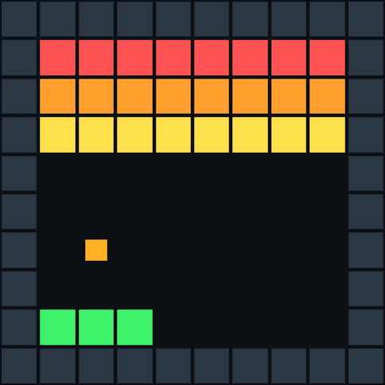
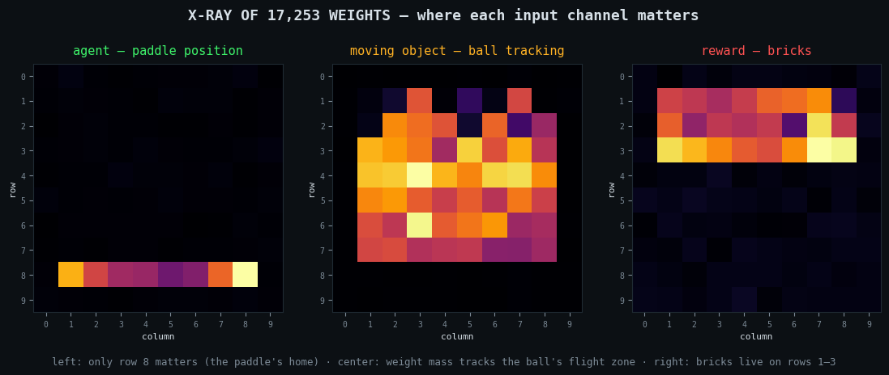
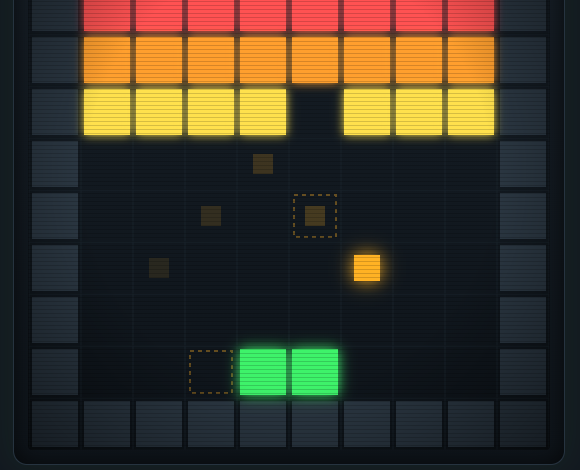
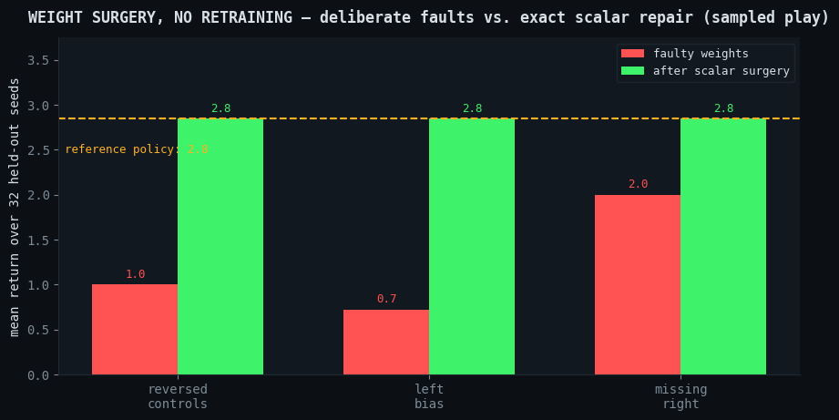
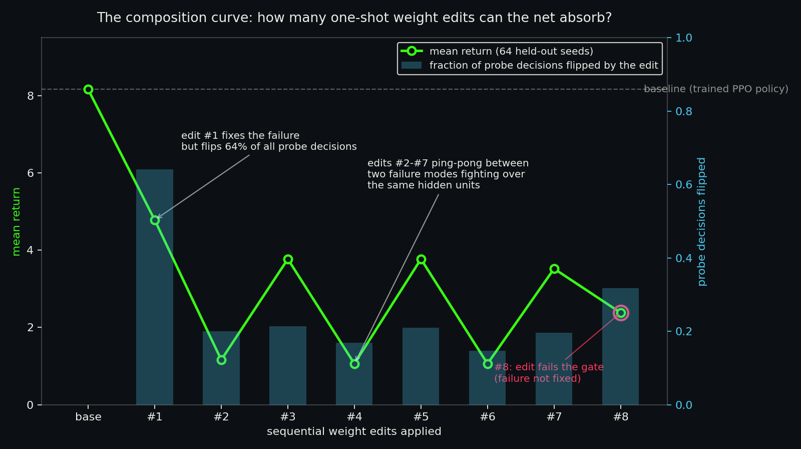

# Breakout Policy Visualizer

**A neural network's raw weights — 17,253 numbers, nothing else — playing Breakout live in your browser.**
No server. No frameworks. No recording. The file of decimals *is* the player.

<p align="center">
  <a href="https://harleycoops.github.io/breakout-policy-visualizer/">
    
  </a>
</p>

<p align="center">
  <b><a href="https://harleycoops.github.io/breakout-policy-visualizer/">Play the live demo</a></b> ·
  <a href="https://huggingface.co/HarleyCooper/grid-policy-mlp">Model on Hugging Face</a> ·
  <a href="https://app.primeintellect.ai/dashboard/environments/harleycooper/kimi-grid-breakout">kimi-grid-breakout on Prime Intellect</a> ·
  <a href="https://app.primeintellect.ai/dashboard/environments/harleycooper/weight-space-breakout">weight-space-breakout on Prime Intellect</a>
</p>

---

## The story in three acts

### Act 1 — Reading a mind from its wiring alone

This project started with a file of 17,253 numbers. No source code, no game, no documentation of what
the network was trained on — just weights. By looking at *where* the numbers were large and where they
were silent, the game was reconstructed from first principles:



- **Agent channel** — near-zero everywhere except **row 8**: the network only cares where the paddle sits.
- **Moving-object channel** — weight mass blankets the ball's flight zone, and together with the
  previous-frame channel it encodes *velocity*, not just position.
- **Reward channel** — concentrated on **rows 1–3**: a stationary brick wall.

Conclusion: **Breakout**. Nobody told us. The knowledge was written into the numbers, and we read it
like an X-ray.

### Act 2 — The numbers still work, anywhere

The weights were exported as a PyTorch model, pushed to
[Hugging Face](https://huggingface.co/HarleyCooper/grid-policy-mlp), downloaded fresh, and verified
end-to-end. Then they were ported to ~40 lines of pure JavaScript — `tanh` matrices and a softmax —
so the *same decimals* now play in any browser tab:



The visualizer renders the game the way the network sees it: five binary channels (agent, ball, bricks,
walls, previous frame), live softmax probabilities for all five actions, and a CRT arcade skin in honor
of the 1976 original.

### Act 3 — Surgery instead of schooling

If a policy makes a mistake, you don't have to retrain it from scratch. Ask a counterfactual question —
*which change to which numbers would have prevented that failure while preserving everything else it does
well?* — solve for the change, and verify by replaying the game:



Three deliberate faults injected into a hand-written Breakout policy — reversed controls, a left bias, a
severed "move right" connection — define tasks accepting **exact scalar edits, zero gradient steps**,
scored by the deterministic physics itself. This describes the benchmark, not three successful LLM repairs; the initial no-tool trial improved one of three faults. That repair loop is the published
benchmark [weight-space-breakout](https://app.primeintellect.ai/dashboard/environments/harleycooper/weight-space-breakout),
where an LLM receives the broken weights and must emit the fix as JSON.

> **Update:** the demo now has a weights selector — *original* (the trained PPO policy),
> *repaired v1* (+1.075, zero observed losses on 1,000 games),
> *repaired v3* (+1.834, 17 losses on that same set), and *repaired v4*
> (+3.299, 20 losses on 1,000 fresh games). These are greedy-mode results,
> not guarantees for sampled browser play. All from the
> [KimiBrainSurgery](https://github.com/HarleyCoops/KimiBrainSurgery) failure gym.
> Same architecture, same code path — only the decimals differ.

### Act 4 — The failure gym

Act 3 repaired faults we injected on purpose. The harder question: **can a system find the failures on
its own?** [`gym/failure_gym.py`](gym/failure_gym.py) is the closed loop — an RL gym where the training
signal is failures, not rewards:

1. **MINE** — greedy rollouts over 200 seeds; a *failure* is the exact decision node where a descending
   ball's landing column (computed by exact forward simulation, wall bounces included) goes from
   coverable to uncoverable because of the chosen paddle action.
2. **DIAGNOSE** — the final layer is linear in the hidden state (`logits = h2 @ W3 + b3`), so the fatal
   logit gap decomposes *exactly* into per-hidden-unit contributions. No gradients, no attribution
   approximations — arithmetic.
3. **SOLVE** — the minimal-norm closed-form edit that flips the decision at the failure state:
   `W3[:, wrong] −= c·h2`, `W3[:, save] += c·h2`, with `c = (gap + margin) / 2‖h2‖²`.
4. **GATE** — regression battery: is the failure fixed? How many probe-state decisions flipped? What
   did the mean return on 64 held-out seeds do?
5. **ITERATE** — apply the edit, re-mine for the *next* failure, repeat.



The result is the honest, publishable finding: **the net absorbs zero clean edits.** Edit #1 fixes its
failure — and flips 64% of all probe decisions as collateral damage, halving the return. Edits #2–#7
ping-pong between two failure modes (a right-edge miss and a left-edge miss) whose culprit hidden units
overlap — each repair steals back the margin the previous one spent. Edit #8 fails the gate outright.

That interference curve *is* the discovery: a 17k-parameter policy trained by PPO packs its decisions
into shared, overlapping features, so single-state edits are never truly local. The next move is
constrained edits — solve for the repair inside the null space of the probe activations, so fixing one
state provably leaves the others untouched. The gym is the instrument that measures whether it works.

```bash
cd gym && python3 failure_gym.py   # numpy only; reproduces the report cards above in ~1 min
```

## Why it matters

Normally, changing what an AI does means retraining: expensive, slow, and you can never be sure what else
changed. Weight-space editing promises something different — behavior as **inspectable, addressable
mathematics**. Find the numbers responsible for a behavior, change exactly those, verify nothing else moved.

And if repair-by-reasoning works on a game, it works on any process with checkable steps: a railroad
engine manual's worth of structured knowledge becomes hyperspecific behavior for the cost of electricity.
Today this works on a 17-thousand-parameter toy. Whether it scales to billion-parameter models is the
open frontier.

## The cast

| Piece | What it is | Where |
|---|---|---|
| `GridPolicyMLP` | The original PPO-trained policy (500→32→32→5, tanh, 17,253 params) | [Hugging Face](https://huggingface.co/HarleyCooper/grid-policy-mlp) |
| This repo | Zero-build static visualizer; pure-JS inference; original vs repaired weights selector | [live demo](https://harleycoops.github.io/breakout-policy-visualizer/) |
| `grid-policy-mlp-repaired` | The policy after 3 kept edits (+1.075 mean, about 12.4%, on the 1,000-game greedy set) | [Hugging Face](https://huggingface.co/HarleyCooper/grid-policy-mlp-repaired) |
| `kimi-grid-breakout` | Closed-loop LLM Breakout environment (verifiers v1) | [Prime Intellect](https://app.primeintellect.ai/dashboard/environments/harleycooper/kimi-grid-breakout) |
| `weight-space-breakout` | Weight-repair benchmark + the authoritative physics | [Prime Intellect](https://app.primeintellect.ai/dashboard/environments/harleycooper/weight-space-breakout) |
| `gym/` | The failure gym: mine → diagnose → solve → gate → iterate | [`gym/failure_gym.py`](gym/failure_gym.py) |

## Run it locally

```bash
git clone https://github.com/HarleyCoops/breakout-policy-visualizer
cd breakout-policy-visualizer
npm run dev    # → http://localhost:7100/
```

Any static file server works — there is no build step. Controls: **Space** play/pause · **S** step ·
**R** reset · speed slider · sampled vs. deterministic policy · optional arcade sound.

## How the inference works

```js
h1 = tanh(x @ W1 + b1)   // 500 → 32
h2 = tanh(h1 @ W2 + b2)  // 32 → 32
logits = h2 @ W3 + b3    // 32 → 5  (noop / up / down / left / right)
```

`weights.json` is the whole model — 17,253 floats exported from the checkpoint. The forward pass above,
plus a softmax sampler, plus the grid physics, is the entire runtime.

---

*Physics engine adapted from [weight-space-breakout](https://app.primeintellect.ai/dashboard/environments/harleycooper/weight-space-breakout) (MIT). Built with [Kimi](https://kimi.com).*

## Evaluation provenance

Published scores use greedy actions; this browser also offers sampled actions.
JavaScript numerical details can differ from the NumPy benchmark near ties.
[Current status](https://github.com/HarleyCoops/FailureIsAllYouNeed/blob/codex/initial-results/docs/STATUS_2026-11-03.md) · [Per-seed dataset](https://huggingface.co/datasets/HarleyCooper/failure-is-all-you-need-evaluations).
